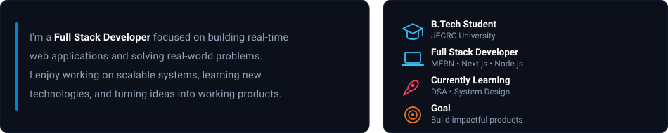
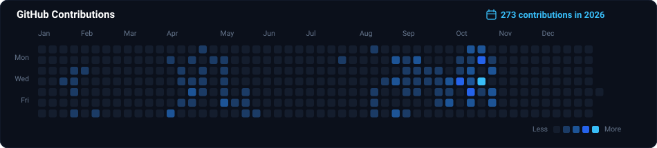
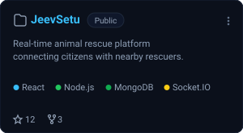
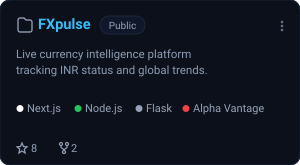
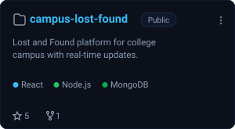

  

 

### 👋 About Me

  

 

### 🛠 Tech Stack

  

 

### 📊 GitHub Contributions

  

 

### 🚀 Featured Projects

  
  
  

  <a href="https://github.com/Prateekverma11?tab=repositories"><em>View all repositories →</em></a>

<!-- 
  ⚡ Real-Time Contribution Updates:
  This repository includes an automated GitHub Action (.github/workflows/update-contributions.yml) 
  that runs every 6 hours and on push to fetch live contribution data directly from GitHub 
  and update assets/contributions.svg automatically!
-->